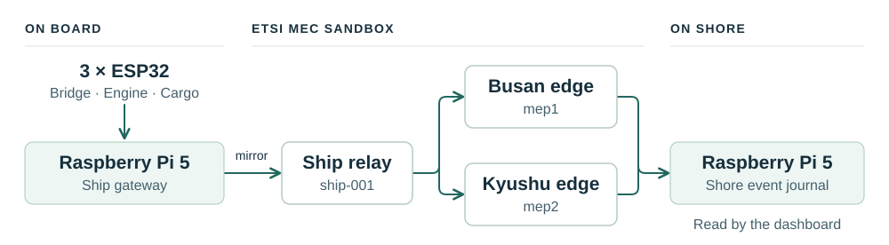

# ANCHOR

**Resilient ship-to-shore IoT with oneM2M**

Team Ctrl+Sea · oneM2M Hackathon 2026

ANCHOR carries sensor readings from a ship to shore across intermittent coastal links. Three ESP32 nodes monitor the bridge, engine room, and cargo hold. One Raspberry Pi 5 collects their readings on board. A second Raspberry Pi 5 receives them on shore.

In the MEC sandbox, the ship relay selects the Busan or Kyushu edge as the vessel moves. If the link drops, the relay queues new readings. Each edge finishes delivering the records it has accepted, even after the ship changes zones.



<a id="역할별-배포와-실행"></a>

## Install

**Dashboard demo.** From the repository root, install the dashboard dependencies with Node.js and npm. The demo includes a sample voyage and runs without hardware.

```sh
cd dashboard
npm ci
```

<a id="httpsmqtts-설정"></a>

**Hardware deployment.** On each Raspberry Pi 5, run `./scripts/install-pi.sh` from the repository root as the service user. Configure the ship and shore endpoints and install each Pi’s TLS certificate. Use the firmware guide for the ESP32 nodes and the MEC guide for the coastal relays. [Firmware and wiring](hardware/firmware/README.md) · [TLS provisioning](scripts/provision-tls.py) · [MEC setup](deploy/mec/README.md)

## Run

**Dashboard demo.** From the `dashboard/` directory, start the development server.

```sh
npm run dev
```

Open [the dashboard](http://localhost:5180/) and move the playback cursor across a link outage to see when queued readings reach shore.

**Live deployment.** On each newly configured Pi, run the launcher for its role from the repository root. Use `role=ship` on board and `role=shore` on shore.

```sh
role=ship
./deploy/"$role"/run.sh check
./deploy/"$role"/run.sh init-cse   # First installation only
./deploy/"$role"/run.sh cse
```

With the oneM2M service running, open a second terminal and run `./deploy/ship/run.sh acp-provision` on the ship Pi and `./deploy/shore/run.sh acp-provision` on the shore Pi. Start the sensor mirror and relays in the sandbox, then connect the Shore Monitor and open `/?live` on the dashboard. [MEC deployment guide](deploy/mec/README.md) · [Live dashboard guide](dashboard/README.md)
