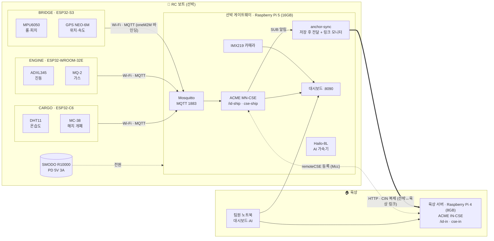

> 이 문서는 TLS 전환 전 하드웨어·구 SQLite 동기화 구성의 과거 기록입니다. 아래 HTTP 주소와 통신 리허설 결과를 현재 HTTPS·MQTTS 구현의 실행 지침이나 검증 결과로 사용하지 않습니다. 현행 배포는 [루트 README](../../README.md), 통합 구현 설명은 로컬 `docs/ANCHOR_OVERVIEW.pdf`·`.md`를 따릅니다.

# ANCHOR 하드웨어 구성 현황

Ctrl+Sea · 2026-11-15 기준 · 실제로 연결하고 동작을 확인한 구성

> 센서 핀 배선의 상세 내용은 [wiring.md](wiring.md)에, 선박 Pi 소프트웨어 설정은 [ship-gateway-pi5/README.md](../ship-gateway-pi5/README.md)에 있다. 이 문서는 전체 그림과 장비, 네트워크, 데이터 흐름을 한곳에 모은 것이다.

---

## 1. 전체 구성도



Mermaid가 렌더링되지 않는 환경에서 보는 텍스트 버전:

```
┌──────────────────────────── RC 보트 ─────────────────────────────┐
│                                                                  │
│  [BRIDGE S3]      [ENGINE WROOM]     [CARGO C6]                  │
│  MPU6050, GPS     ADXL345, MQ-2      DHT11, MC-38                │
│       │                │                 │                       │
│       └────── Wi-Fi + MQTT (oneM2M) ─────┘                       │
│                        ▼                                         │
│  ┌──────────── Raspberry Pi 5 (선박 게이트웨이) ──────────────┐  │
│  │ Mosquitto ─▶ ACME MN-CSE ─SUB─▶ anchor-sync (SQLite 큐)    │  │
│  │ IMX219 카메라 ─▶ 대시보드 :8090    Hailo-8L (이상탐지 예정) │  │
│  └──────────────────────────────┬─────────────────────────────┘  │
│  보조배터리 SMODO R10000 ───────┘ (USB-C PD 5V 3A)               │
└─────────────────────────────────┼────────────────────────────────┘
                                  │ 선박↔육상 링크 (지금은 핫스팟, 이후 넷기어 AP)
                                  ▼  HTTP: CIN 복제 + remoteCSE
                     ┌──── Raspberry Pi 4 (육상) ────┐
                     │ ACME IN-CSE  /id-in, cse-in   │
                     │ ship-gw/<노드>/<센서> 에 복제 │
                     └───────────────────────────────┘
```

---

## 2. 장비 목록

### 2.1 게이트웨이 / 서버

| 역할 | 장비 | 주요 사양 | 연결된 주변장치 | 전원 |
|---|---|---|---|---|
| 선박 게이트웨이 (MN-CSE) | Raspberry Pi 5 Model B | RAM 16GB, microSD 64GB | IMX219 카메라 (CAM/DISP0 포트), Hailo-8L AI 가속기 (13 TOPS, `/dev/hailo0`) | SMODO R10000 보조배터리 (USB-C PD 5V 3A), `usb_max_current_enable=1` |
| 육상 서버 (IN-CSE) | Raspberry Pi 4 Model B | RAM 8GB, microSD 8GB (여유 약 1.1GB) | 없음 | 상시 어댑터 |

- Pi 5는 다른 프로젝트(Thread/Matter, Hailo 데모 등)와 같이 쓰는 장비다. ANCHOR 관련 파일은 모두 `~/anchor` 아래에 있다.
- Hailo-8L은 선박 쪽 로컬 이상탐지 모델용으로 확보해 두었다. 모델은 팀에서 정하는 중이다.

### 2.2 센서 노드 (ESP32 3대)

| 노드 | 보드 | 센서 | 인터페이스 / 핀 | oneM2M AE (Originator) | 컨테이너와 주기 |
|---|---|---|---|---|---|
| **BRIDGE** (조타실) | ESP32-S3 | MPU6050 (GY-521) | I2C 0x68, SDA 8 / SCL 9 | `bridge` (`CBridge`) | `attitude` 1Hz (실시간 스트림 20Hz는 별도) |
| | | GPS NEO-6M | UART 9600, TX→GPIO18, RX←GPIO17 | | `position` 0.5Hz |
| **ENGINE** (기관실) | ESP32-WROOM-32E | ADXL345 (GY-291) | I2C 0x53, SDA 21 / SCL 22, 200Hz 샘플링 | `engine` (`CEngine`) | `vibration` 1Hz (RMS, 최대값) |
| | | MQ-2 | 아날로그, AO → 분압(10k/20k) → GPIO34 | | `gas` 1Hz |
| **CARGO** (화물칸) | ESP32-C6 | DHT11 | GPIO4 | `cargo` (`CCargo`) | `climate` 5초 |
| | | MC-38 도어센서 | GPIO5 (내부 풀업), 반대쪽 GND | | `hatch` 상태가 바뀔 때 즉시 + 30초마다 |

- 예비 보드로 ESP32-C6 1개가 더 있다.
- 노드는 모두 USB 5V로 전원을 받는다. ESP32와 Pi 5 사이에 선은 없고 Wi-Fi로만 통신한다.
- 세 노드 모두 **OTA 무선 업데이트**를 지원한다. 노트북에서 Pi 5를 거쳐 올린다([`firmware/ota.sh`](../firmware/ota.sh)).

### 2.3 MPU6050 장착 방향 (BRIDGE)

```
          선수 (bow)
             ▲
             │  X 화살표가 선수 방향
        ┌────┴────┐
        │ MPU6050 │  부품면이 위를 향하게
        └─────────┘
  roll  + : 우현(오른쪽)이 아래로 기울 때
  pitch + : 선수가 아래로 숙일 때
```

- 보트에 고정한 뒤 대시보드의 **영점** 버튼을 누르면 현재 자세가 0°로 저장된다. 이 값은 ESP32 플래시에 보관된다.

---

## 3. 네트워크

| 장비 | 테스트망 (폰 핫스팟 `ms1234`, 2.4GHz) | Tailscale (원격 접속) | 비고 |
|---|---|---|---|
| Pi 5 (호스트명 `PIKING`) | **10.251.196.250** (고정 보조 IP) + DHCP 주소 | (팀 Tailscale) | mDNS 이름 `piking.local` |
| Pi 4 (호스트명 `raspberrypi`) | 10.251.196.64 | (팀 Tailscale) | |
| BRIDGE S3 | DHCP (현재 .22) | — | OTA 호스트명 `anchor-bridge` |
| ENGINE WROOM | DHCP (현재 .41) | — | `anchor-engine` |
| CARGO C6 | DHCP (현재 .180) | — | `anchor-cargo` |

- **ESP32는 Pi 5를 IP가 아니라 mDNS 이름(`piking`)으로 찾는다.** 핫스팟은 MAC 주소로 IP를 정하는데, Pi 5와 C6가 같은 주소(.180)를 받게 돼 있어서 먼저 붙은 쪽이 가져간다. 그래서 IP를 펌웨어에 고정하지 않았다.
- Pi 5에는 IN-CSE가 찾아올 수 있도록 고정 보조 IP **.250**을 따로 붙여 두었다.
- 두 Pi 모두 `ms1234`의 접속 우선순위를 높게 설정해 두었다. 다만 다른 와이파이에 이미 붙어 있으면 자동으로 옮겨 가지 않는다. 그럴 때는 `sudo nmcli con up ms1234`로 직접 전환한다.
- **예정:** 넷기어 A6210 동글이 도착하면 선박 내부망(ESP32↔Pi 5)과 선박↔육상 링크를 분리한다. 지금은 둘 다 핫스팟 하나를 같이 쓴다.

### 접속 주소

| 용도 | 주소 |
|---|---|
| 선박 대시보드 | http://10.251.196.250:8090 (핫스팟) |
| 육상 관제 대시보드 | http://10.251.196.64:8090 (핫스팟) |
| 선박 MN-CSE | `http://10.251.196.250:8080/~/id-ship/cse-ship` |
| 육상 IN-CSE | `http://10.251.196.64:8080/~/id-in/cse-in` |
| 육상에서 선박 데이터 조회 | `http://10.251.196.64:8080/~/id-ship/cse-ship/...` (IN이 선박으로 전달) |
| 육상에 복제된 데이터 | `http://10.251.196.64:8080/~/id-in/cse-in/ship-gw/<노드>/<센서>` |

요청 헤더: `X-M2M-Origin: CAdmin`, `X-M2M-RVI: 3`, `X-M2M-RI: <임의값>`, `Accept: application/json`

---

## 4. 데이터 흐름

1. **센서 → 선박 CSE.** ESP32가 oneM2M MQTT 바인딩으로 CIN을 만든다. 토픽은 `/oneM2M/req/<Originator>/id-ship/json`이다. 각 CIN의 `con`에는 `seq`(순번)와 `ts`(NTP로 맞춘 UTC 밀리초)가 붙는다.
2. **실시간 경로.** BRIDGE는 일반 MQTT 토픽 `anchor/live/bridge/attitude`로 자세를 20Hz로 따로 보낸다. 대시보드의 3D 보트 애니메이션이 이 값을 쓴다. 이 경로는 CSE에 저장되지 않는다.
3. **명령.** 대시보드에서 영점 버튼을 누르면 `bridge/command`에 CIN이 생기고, 구독(SUB)을 통해 ESP32로 전달된다.
4. **선박 → 육상 복제.** `anchor-sync`가 선박 CSE의 7개 컨테이너를 구독한다. 새 CIN은 먼저 SQLite 큐에 저장한 뒤 육상 IN-CSE `ship-gw/...`에 같은 내용으로 만든다. 이때 `con`에 다음 두 값을 더한다.
   - `ship_ct`: 선박에서 처음 생성된 시각
   - `fwd_delay_s`: 육상에 도착하기까지 걸린 시간(초)
5. **링크가 끊기면.** 큐에 계속 쌓아 두었다가, 링크가 복구되면 순서대로 다시 보낸다. 큐는 최대 20만 건(약 14시간 분량)까지 보관한다.
6. **링크 모니터.** 5초마다 IN-CSE 응답 시간을 재고, Pi 5의 와이파이 신호 세기와 큐 길이를 함께 `sync/link`에 기록한다. 상태는 `ONLINE` / `DEGRADED` / `OFFLINE` 셋 중 하나다. 이 기록도 육상으로 복제되므로, 끊겨 있던 동안의 상태 변화를 나중에 육상에서 볼 수 있다.

---

## 5. 전원

| 대상 | 현재 | 비고 |
|---|---|---|
| Pi 5 | SMODO R10000 (10000mAh, PD 5V 3A) | 카메라와 Hailo를 포함해 동작 확인 |
| ESP32 3대 | USB 5V (테스트 중에는 노트북이나 충전기) | 보트에 실을 때 전원 분배 방식 결정 필요 |
| Pi 4 | 상시 어댑터 | 육상 |

⚠️ **Pi 5는 반드시 `sudo shutdown -h now`로 종료한 뒤에 전원을 뽑는다.** 그냥 뽑으면 ACME DB(TinyDB)가 깨진다. 깨진 DB는 부팅할 때 자동으로 치워지고 새 DB로 시작하지만, 그동안 쌓인 데이터는 사라진다. 이 문제로 멘토에게 질문을 올려 두었다.

---

## 6. 동작 확인 현황 (11/15)

| 항목 | 상태 |
|---|---|
| 3개 노드 → 선박 CSE CIN 적재 | ✅ |
| MPU6050 자세, 상보필터, 20Hz 실시간 스트림 | ✅ |
| 영점 명령 (oneM2M SUB로 전달) | ✅ |
| ADXL345 진동 | ✅ |
| DHT11 온습도 | ✅ |
| GPS | ⚠️ 모듈 응답은 OK, 실내라 위치(fix) 미확보 → 야외에서 확인 필요 |
| MQ-2 가스 | ⚠️ 0.213V로 고정 → 배선과 분압 회로 점검 필요 |
| MC-38 해치 | ⏳ 센서 장착 전 (지금은 open으로 표시) |
| IMX219 카메라 → 대시보드 | ✅ (리본 케이블이 헐거우면 멈춤 → 고정 필요) |
| OTA (세 노드 모두) | ✅ |
| 육상 IN-CSE (ACME, Pi 4) | ✅ 11/15 tinyIoT에서 ACME로 전환 |
| 선박 → 육상 복제 (anchor-sync) | ✅ 91초 단절 리허설: 보관 데이터 406건 복구, 순번 검증 누락 0건 |
| 육상 관제 대시보드 (Pi 4) | ✅ http://10.251.196.64:8090 · 두절/복구 표시, 빈 구간 채움 |
| Hailo-8L 이상탐지 | ⏳ 모델 선정 중 |

## 7. 남은 하드웨어 작업

- [ ] MQ-2 배선과 분압 점검 (AO 전압을 멀티미터로 측정)
- [ ] MC-38을 화물칸 해치에 장착
- [ ] 카메라 리본 케이블 고정
- [ ] 보트 장착: 방수박스, ESP32 전원 분배, MPU6050 방향 맞추기, 장착 후 영점 조정
- [ ] 넷기어 A6210으로 선박 내부망과 선박↔육상 링크 분리
- [ ] 호수 시연 전 야외 테스트 (GPS fix, 거리별 링크 상태)
